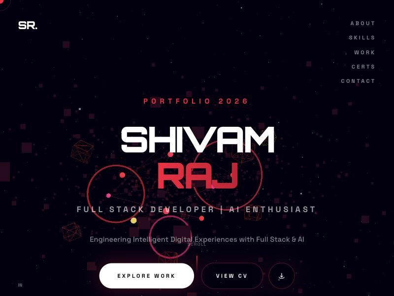

# Shivam Raj — 3D Portfolio

A cinematic, space-themed developer portfolio built with Next.js and Three.js. Visitors enter through an animated "big bang" intro, then scroll through 3D scenes covering my background, skills, projects, and certifications.

**Live site:** [shivam-dev-9.vercel.app](https://shivam-dev-9.vercel.app)



## Tech stack

| Area | Tools |
|---|---|
| Framework | Next.js 15 (App Router), React 19, TypeScript |
| 3D | Three.js, React Three Fiber, Drei |
| Animation | Framer Motion, GSAP |
| Scrolling | Lenis |
| Styling | Tailwind CSS |
| Hosting | Vercel |

## Sections

| Section | Component |
|---|---|
| Intro loader | `components/BigBangLoader.tsx` |
| Hero | `components/HeroScene.tsx` |
| About, training, education | `components/JourneyScene.tsx` |
| Skills | `components/SkillsGalaxy.tsx` |
| Projects and detail popup | `components/ProjectsUniverse.tsx`, `components/ProjectModal.tsx` |
| Certifications | `components/AchievementsScene.tsx` |
| Motto and soft skills | `components/MottoSection.tsx` |
| Contact | `components/ContactPlanet.tsx` |

## Run locally

Requires Node.js 18.18 or newer. No environment variables are needed.

```bash
npm install
npm run dev
```

Then open [http://localhost:3000](http://localhost:3000).

To check a production build:

```bash
npm run build
npm start
```

`.npmrc` sets `legacy-peer-deps=true`, so keep that file when installing.

## Editing content

All text content lives in [`data/portfolio.ts`](data/portfolio.ts), so most updates don't touch any components.

**To add a project**, append an object to the `projects` array:

```ts
{
  id: "my-project",
  name: "My Project",
  tagline: "One-line summary",
  description: "Shown in the popup.",
  features: ["Feature one", "Feature two"],
  tech: ["React", "Node.js", "MongoDB"], // the first 3 appear on hover
  skillsDemonstrated: ["Skill one"],
  image: "/projects/my-project.png",     // optional, stored in public/projects/
  color: "#ff4d79",                      // drives the planet and popup glow
  accentColor: "#990024",
  github: "https://github.com/...",
  live: "https://...",                   // optional, adds a Live Demo button
},
```

Certificate images go in `public/certs/`. To update the CV, replace `public/Shivam_Raj_CV.pdf`.

## Project structure

```text
app/          Root layout, page order, global styles
components/   One file per scene, plus navbar, cursor, and smooth scroll
data/         All portfolio content
hooks/        Mobile detection and scroll progress
public/       CV, project images, certificate images
```

## Deployment

The site deploys on Vercel as a standard Next.js project, with no extra configuration.

## Contact

- [LinkedIn](https://www.linkedin.com/in/shivam-raj-9s)
- [GitHub](https://github.com/ShivamRaj9188)
